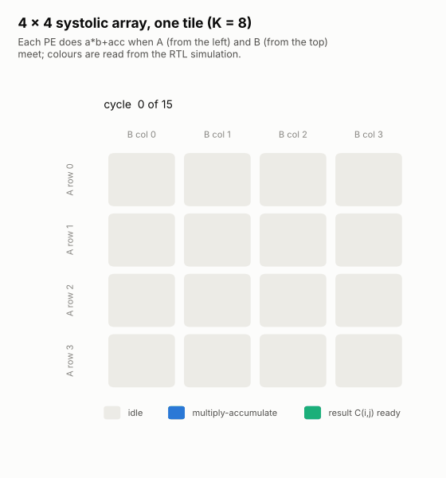
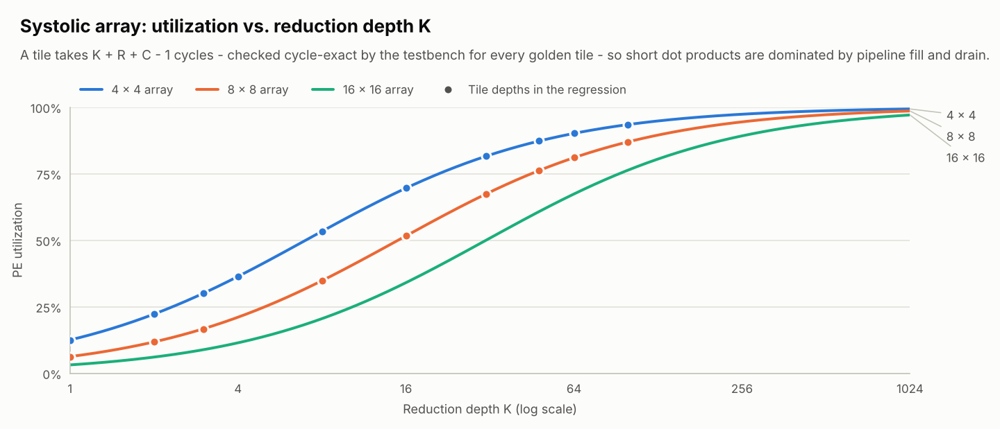
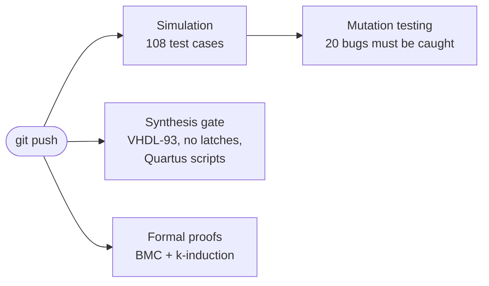

# Digital design in VHDL — from gates to a systolic-array accelerator

[](https://github.com/Doufless1/VHDL/actions/workflows/ci.yml)


My VHDL work from the *Introduction to VHDL* course at Saxion University of Applied
Sciences (spring 2025), rebuilt to industry practice and extended with a DSP filter
and an INT8 matrix-multiply engine. Every design is simulated against a reference
model, synthesized, checked for latches and — where it matters — formally proven,
and the testbenches themselves are mutation-tested. All of it runs automatically
on every push.

<p align="center">
<picture>
  <source media="(prefers-color-scheme: dark)" srcset="docs/images/systolic_wavefront_dark.gif">
  
</picture>
<br><sub>The INT8 systolic array computing one matrix tile — every frame read from the RTL simulation trace.</sub>
</p>

## At a glance

| | |
|---|---|
| **13 design folders, 24 RTL units** — combinational logic to an AI-accelerator core | **108 self-checking test cases**, all passing in CI in about 30 s |
| **2,240,652 vectors** exhaustively verify the PIC16 ALU against an independent model | **~118,000 INT8 multiply-accumulates** checked bit-exact against NumPy per run |
| **2 formal proofs** (bounded model check + k-induction) — one found a real power-up bug | **20 / 20 injected bugs** caught by mutation testing of the testbenches |
| **No accidental latches, strict VHDL-93 RTL** — both enforced by CI | **Lab designs ran on an Intel MAX 10** board; their pin maps live on as Tcl projects |

## Featured work

### INT8 systolic array — the core of an inference accelerator
A `ROWS` × `COLS` grid of multiply-accumulate units computing `C = A·B` with INT8
operands and INT32 accumulation. Skewed operand streams, a valid/ready interface,
and a `first` tag that travels with the data so no global clear has to fan out to
every PE. Checked bit-exact against a NumPy golden model at five array sizes —
including a fully-connected layer tiled onto the array the way an accelerator
compiler would — with the latency verified cycle-exactly.
**→ [designs/04_capstones/systolic_array](designs/04_capstones/systolic_array/)**

<picture>
  <source media="(prefers-color-scheme: dark)" srcset="docs/images/systolic_utilization_dark.png">
  
</picture>

### Formal verification that found a bug simulation could not
The traffic-light controller's safety rules — pedestrians walk only on car-red,
orange always precedes red, exact phase lengths, and a *tight* bound on how long a
pedestrian waits — are proven for every possible input sequence. The first proof
attempt failed in cycle 0: the state register could power up in an unused encoding
with **no lamp lit**. Every testbench starts with a reset, so simulation never saw it.
A second proof shows the UART transmitter puts every accepted byte on the wire
bit-exact. **→ [formal/](formal/)**

### Moving-average filter — streaming DSP in O(1) hardware
A running sum instead of an adder tree, a power-of-two window so the division is a
free shift, and an accumulator sized for bit growth: one adder and one subtractor
for any window length. **→ [designs/04_capstones/moving_average_filter](designs/04_capstones/moving_average_filter/)**

<picture>
  <source media="(prefers-color-scheme: dark)" srcset="docs/images/moving_average_dark.png">
  
</picture>

## All designs

| Category | Design | What it demonstrates | Verification |
|---|---|---|---|
| Common | [`sync_2ff`](designs/00_common/) | Clock-domain crossing, metastability | via UART, traffic light |
| Combinational | [Adders](designs/01_combinational/adders/) | Gate equations → structural `for-generate` | Exhaustive, 131 k vectors |
| | [Data routing](designs/01_combinational/data_routing/) | Mux, demux, decoder, tri-state bus | Exhaustive + bus contention |
| | [Seven-segment + parity](designs/01_combinational/seven_segment/) | Hierarchy, active-low outputs | Independent segment spec |
| Sequential | [D register](designs/02_sequential/d_register/) | Edge polarity, asynchronous reset | Directed + random |
| | [Inferred latch](designs/02_sequential/inferred_latch/) | The classic bug, its fix, a CI gate | Shows the memory effect |
| | [Up/down counter](designs/02_sequential/up_down_counter/) | `numeric_std`, wrap-around | 5000-cycle reference model |
| Systems | [Traffic light](designs/03_systems/traffic_light/) | Timed FSM, synchronized request | Monitor + **formal proof** |
| | [PIC16 execute stage](designs/03_systems/pic16_alu/) | Real instruction decoding, STATUS flags | **2.24 M** exhaustive vectors |
| | [Single-port RAM](designs/03_systems/single_port_ram/) | Block-RAM inference, read latency | Shadow-memory scoreboard |
| | [UART TX/RX](designs/03_systems/uart/) | Valid/ready IP, centre sampling, framing errors | BFMs, ±3 % baud, **formal proof** |
| Capstones | [Moving-average filter](designs/04_capstones/moving_average_filter/) | Streaming DSP, bit growth | Scoreboard, 3 window sizes |
| | [INT8 systolic array](designs/04_capstones/systolic_array/) | Matrix engine, dataflow, tiling | **NumPy golden model**, 5 sizes |

Each folder has its own README: interface, design decisions, test plan, and
implementation numbers (Quartus lab compiles or Yosys estimates, always labelled).

## How it is verified



Exhaustive testing where the input space allows it, reference models written
*differently* from the RTL, scoreboards for streams, bus-functional models for
protocols, always-on safety monitors, golden-model co-verification, formal proofs —
and mutation testing to prove the tests would catch real bugs.
**→ [docs/verification.md](docs/verification.md)**

## Engineering log

The original lab repository was 99 % Quartus output, had no timing constraints, and
contained a UART testbench that printed `'H'` as `0x84` and a latch exercise that
did not infer a latch. The new checks also caught mistakes in the new code — a test
that could never fail, an untested RAM latency, a CI pipeline that could have
passed with a failing proof. All 19 findings, with evidence and fixes:
**→ [docs/engineering-log.md](docs/engineering-log.md)**

## Quick start

```bash
# Ubuntu 24.04 (Windows: use WSL)
sudo apt install ghdl-mcode yosys yosys-plugin-ghdl z3 tcl
pip install -r requirements.txt

make test        # all 108 test cases                 ~30 s
make formal      # prove the PSL properties           ~35 s
make synth       # synthesis + latch + VHDL-93 gate
make report      # resource-usage table
make mutation    # inject 20 bugs, all must be caught ~1 min
make figures     # re-simulate and redraw docs/images
```

FPGA build with Quartus Prime Lite (MAX 10 lab board):

```bash
quartus_sh -t designs/03_systems/uart/quartus/serial_text_transmitter.tcl
quartus_sh --flow compile build/quartus/serial_text_transmitter/serial_text_transmitter
```

## Repository layout

```
designs/<category>/<design>/{rtl,tb,quartus}   source, testbenches, FPGA projects
formal/                                        PSL property harnesses
scripts/                                       golden model, checks, figures, Quartus helper
docs/                                          verification, design flow, coding style, log
run.py · Makefile · .github/workflows/ci.yml   regression and automation
```

More: [design flow](docs/design-flow.md) · [coding style](docs/coding-style.md)

## Skills demonstrated

| Area | Evidence |
|---|---|
| RTL design | FSMs, datapaths, pipelines, memories, generics and `generate`, valid/ready interfaces |
| DSP | Recursive moving-average filter, bit-growth analysis, fixed-point rounding |
| Hardware for ML inference | INT8 MAC array, systolic dataflow, layer tiling, utilization model |
| Clock domains and robustness | Synchronizers, glitch filtering, framing errors, safe power-up state |
| Verification | VUnit, OSVVM, scoreboards, BFMs, NumPy golden models, exhaustive testing |
| Formal methods | PSL properties, bounded model checking, k-induction, counterexample debugging |
| Verification quality | Mutation testing of the testbenches |
| FPGA implementation | Quartus Tcl projects, SDC timing constraints, pin assignments, Intel MAX 10 |
| Automation | Python, Tcl, Make, GitHub Actions |

## Background and credits

The designs in `01`–`03` started as lab exercises of Saxion's *Introduction to
VHDL* course (February–April 2025); the original lab code is preserved in the git
history (`git log --follow` on any design file leads back to it). The week-1 adder
is based on a course template by J.S.D. Stokkink. The lecture slides in
[`docs/course-material`](docs/course-material/) are the instructor's work and are
included for context only. The UART receiver, the moving-average filter, the
systolic array, all testbenches, the formal harnesses and the tooling were added on
top of the course.

Maintained by [@Doufless1](https://github.com/Doufless1).
