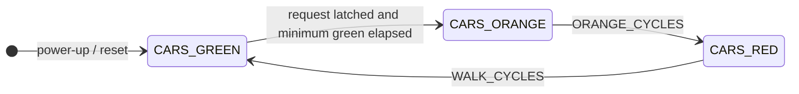
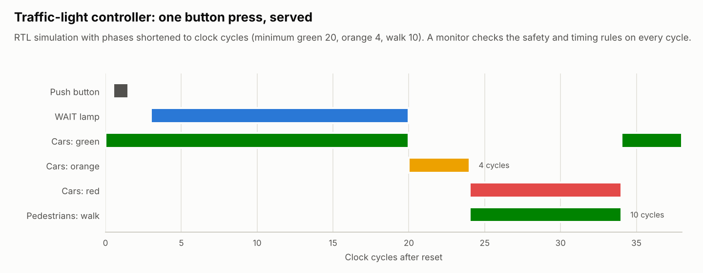

# Traffic-light controller — a timed FSM, simulated *and* formally proven

> Course week 5 (state machines) · extended to realistic timing · safety properties proven

A pedestrian-crossing controller: cars have green until a pedestrian presses the
button; after a minimum green time the cars get orange, then red while pedestrians
walk.

| File | Contents |
|---|---|
| [`rtl/traffic_light_controller.vhd`](rtl/traffic_light_controller.vhd) | Moore FSM + phase timer + synchronized request latch |
| [`tb/tb_traffic_light.vhd`](tb/tb_traffic_light.vhd) | Scenario tests + an always-on safety/timing monitor |
| [`../../../formal/traffic_light/`](../../../formal/traffic_light/) | PSL properties, proven with Yosys + Z3 |
| [`quartus/`](quartus/) | Compile-only project for the 50 MHz board clock |

## From lab exercise to controller

The lab version changed state on **every clock edge**: at 50 MHz the orange and
the pedestrian walk lasted 20 ns. The controller now has:

- **Timed phases** — one down-counter loaded with the phase duration on entry;
  durations are generics (defaults: minimum green 5 s, orange 3 s, walk 8 s at
  50 MHz).
- **A synchronized, latched request** — the button is asynchronous to the clock,
  so it passes [`sync_2ff`](../../00_common/rtl/sync_2ff.vhd) first; a short press
  sets a latch and is never lost; contact bounce only re-sets the latch, so no
  debouncer is needed. Presses during orange/walk are ignored.
- **A WAIT lamp** (`ped_wait`) that shows the request was registered.
- **Explicit power-up values** — see the formal finding below.

<picture>
  <source media="(prefers-color-scheme: dark)" srcset="../../../docs/images/traffic_light_dark.png">
  
</picture>

## Verification in simulation

The testbench has a **monitor process that runs during every test** and checks,
every cycle: exactly one car lamp is lit, pedestrians walk only on car-red, the
phase order is green → orange → red → green, orange lasts exactly `ORANGE_CYCLES`,
walk exactly `WALK_CYCLES`, and green at least `MIN_GREEN_CYCLES`. The scenarios
only have to steer the controller into interesting situations:

| Test case | Scenario |
|---|---|
| `no_request_keeps_cars_green` | No button: green forever, WAIT lamp off |
| `short_press_is_served` | One-clock press → WAIT → orange → walk → green, exactly once |
| `late_press_switches_after_sync_delay` | Press after the minimum green: orange within 4 cycles (2 sync flops + latch + state) |
| `press_during_walk_is_ignored` | No second cycle is queued by a press during walk |
| `bouncing_button_gives_one_walk_phase` | Contact bounce gives exactly one walk phase |
| `reset_during_walk_returns_to_green` | Asynchronous reset forces a safe state immediately |

## Formal verification

Simulation checks the situations someone thought of. The
[formal harness](../../../formal/traffic_light/traffic_light_formal.vhd) states the
rules as PSL properties, and a model checker proves them for **every** possible
sequence of button presses and resets — bounded model check from power-up plus
k-induction, which together prove them for all time:

| Property | Meaning |
|---|---|
| `walk_only_when_cars_stopped` | `ped_green` implies car red and no other car lamp |
| `one_car_lamp` | Exactly one car lamp lit, in every cycle |
| `ped_lamps_complementary` | Pedestrian red = not pedestrian green |
| `no_green_to_red`, `orange_then_red`, `red_then_green` | Phase order (unless reset intervenes) |
| `orange_duration`, `walk_duration` | Exact phase lengths, as PSL sequences |
| `request_served_in_time` | A WAIT lamp is followed by walk within `MIN_GREEN + ORANGE − 1` cycles |

The response bound is **tight**: with one cycle less, the solver produces a
counterexample (a press latched one cycle into a fresh green phase).

### What the proof found

The first proof attempt failed in the very first cycle: the three-state FSM is
encoded in 2 bits, so a fourth encoding exists, and without a reset the register
could power up there — **with no car lamp lit at all**. Simulation never showed it,
because every testbench starts with a reset. The controller now declares explicit
power-up values (FPGA registers support them), so it is in a safe state from the
first clock even if nobody presses reset.

Run: `make formal` (or `python scripts/formal_check.py traffic_light`).

## Implementation

| Design | Quartus Prime 20.1, MAX 10 | Yosys estimate, current RTL |
|---|---|---|
| Lab version (no timing) | 4 LEs, 3 registers | — |
| Current, 50 MHz defaults (29-bit phase timer) | — | 91 LUT4 + 27 carry, 34 flip-flops |
