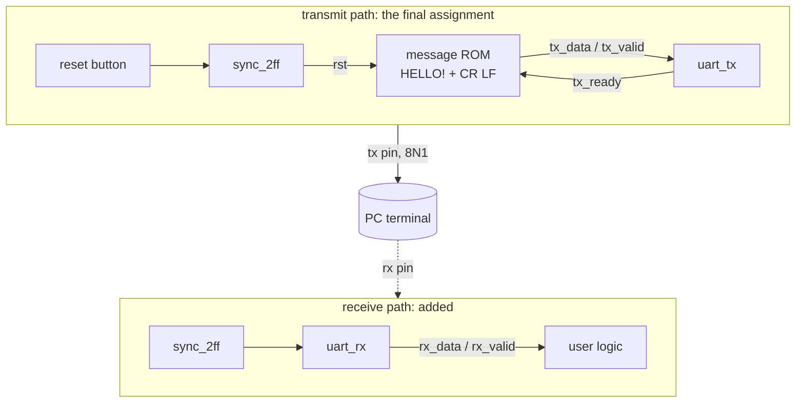
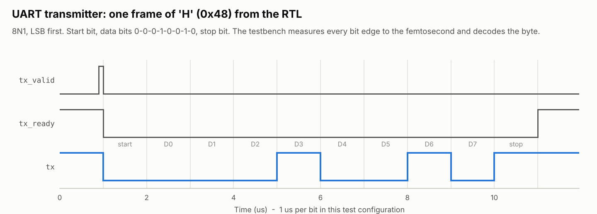

# UART — transmitter, receiver and the "HELLO!" final assignment

> Course final assignment (serial send, 9600 baud) · receiver added · transmitter formally proven

| File | Contents |
|---|---|
| [`rtl/uart_tx.vhd`](rtl/uart_tx.vhd) | Reusable 8N1 transmitter with a valid/ready byte interface |
| [`rtl/uart_rx.vhd`](rtl/uart_rx.vhd) | 8N1 receiver: synchronizer, centre sampling, glitch filter, framing errors |
| [`rtl/serial_text_transmitter.vhd`](rtl/serial_text_transmitter.vhd) | The final assignment: sends `HELLO!\r\n` forever |
| [`tb/uart_bfm_pkg.vhd`](tb/uart_bfm_pkg.vhd) | Bus-functional models: an ideal UART sender and receiver |
| [`tb/tb_uart_tx.vhd`](tb/tb_uart_tx.vhd), [`tb/tb_uart_rx.vhd`](tb/tb_uart_rx.vhd), [`tb/tb_serial_text_transmitter.vhd`](tb/tb_serial_text_transmitter.vhd) | Self-checking tests |
| [`../../../formal/uart_tx/`](../../../formal/uart_tx/) | End-to-end formal proof of the transmitter |

<picture>
  <source media="(prefers-color-scheme: dark)" srcset="../../../docs/images/uart_frame_dark.png">
  
</picture>

## From the lab version to reusable IP

The lab design fused everything into one state machine: a free-running baud tick,
the bit sequencing and a hard-coded six-character ROM, with an unused `START_BIT`
state. It worked — the original testbench shows `HELLO!` arriving — but nothing in
it could be reused. Now:

- **`uart_tx`** takes bytes through a **valid/ready handshake** (AXI4-Stream style),
  so any producer can drive it; holding `tx_valid` high streams back-to-back frames.
  The bit counter restarts with every frame, so every bit lasts exactly
  `CLKS_PER_BIT = round(CLK_FREQ / BAUD)` cycles (+0.006 % error at 50 MHz / 9600).
- **`uart_rx`** is new: the input is asynchronous (the sender has its own crystal),
  so it is synchronized first; the start bit is re-checked half a bit later
  (glitches are ignored); bits are sampled in their centre (tolerates about ±4 %
  baud mismatch); a `'0'` stop bit raises `frame_error`, and the receiver then
  waits for the line to go idle (break condition).
- **`serial_text_transmitter`** is the assignment rebuilt on top: a message ROM
  generated from a `string` generic feeds `uart_tx`; the reset button is
  synchronized.

## Verification

The bus-functional models in `uart_bfm_pkg` behave like real devices on the line:
`uart_send` can play a sender with a wrong clock or a broken stop bit,
`uart_receive` decodes frames like a PC would.

| Bench | Test case | What it checks |
|---|---|---|
| tx | `frame_timing_is_exact` | `0x55` toggles every bit: all 10 edges exactly one bit time apart |
| tx | `back_to_back_stream_has_no_gaps` | A random stream arrives intact and at full line rate |
| tx | `data_is_captured_at_handshake` | Changing `tx_data` mid-frame does not corrupt the frame |
| tx | `single_byte`, `idle_line_is_high_and_ready`, `baud_rate_error_below_one_percent` | Basics, return to idle |
| rx | `receives_every_byte_value` | All 256 byte values |
| rx | `tolerates_sender_3_percent_slow` / `_fast` | Sender clock off by ±3 % |
| rx | `flags_framing_error_and_recovers` | Stop bit `'0'` → `frame_error`, byte dropped, next byte fine |
| rx | `ignores_start_bit_glitch` | A quarter-bit low pulse produces nothing |
| rx | `recovers_from_break_condition` | Line held low for 3 frames → one error, then normal |
| rx | `loopback_with_uart_tx` | Real transmitter → real receiver, random bytes |
| top | `sends_message_repeatedly`, `reset_restarts_the_message` | The assignment at its real 50 MHz / 9600 baud settings |

Both UART benches run in two configurations — 10 clocks per bit for speed and the
real 50 MHz / 9600 baud board settings: `python run.py "*uart*"`.

**A bug in the original testbench:** its hand-written hex formatter emitted the
nibbles in reverse order, so `'H'` (0x48) was printed as `0x84`. The BFM now uses
VHDL-2008's standard `to_hstring`.

## Formal proof of the transmitter

[`formal/uart_tx`](../../../formal/uart_tx/uart_tx_formal.vhd) attaches a small
reference model that records every accepted byte and proves, for every byte value
and every handshake timing, that the line carries exactly that frame — start bit,
data LSB first, stop bit, each bit for exactly `CLKS_PER_BIT` cycles — that
`tx_ready` is low for exactly one frame per byte, and that the idle line is high.
A mutant that sends MSB first is rejected by the solver.

## Implementation

| Design | Quartus Prime 20.1, MAX 10 | Yosys estimate, current RTL |
|---|---|---|
| Lab `serial_text_transmitte` | 50 LEs, 30 registers | — |
| `serial_text_transmitter` (current) | — | 48 LUT4 + 14 carry, 32 flip-flops |
| `uart_tx` / `uart_rx` | — | 39 / 48 LUT4, 27 / 39 flip-flops |

Hardware: `quartus_sh -t designs/03_systems/uart/quartus/serial_text_transmitter.tcl`,
then connect `tx` to the RX pin of a 3.3 V USB-serial adapter and open a terminal at
9600 baud, 8N1.
