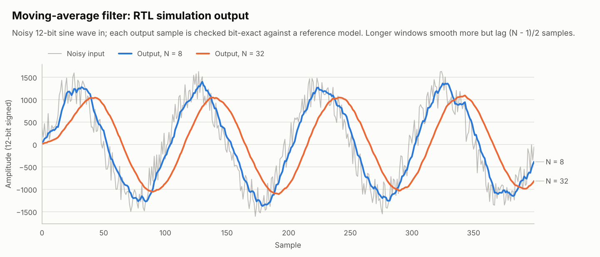

# Moving-average filter — streaming DSP with O(1) hardware

> Capstone · the course's second final assignment ("moving average filter"), built as reusable IP

<picture>
  <source media="(prefers-color-scheme: dark)" srcset="../../../docs/images/moving_average_dark.png">
  
</picture>

A boxcar FIR filter that accepts one sample per clock:

$$y[n] = \frac{1}{N}\sum_{i=0}^{N-1} x[n-i], \qquad N = 2^{k}$$

where *k* is the `LOG2_TAPS` generic.

| File | Contents |
|---|---|
| [`rtl/moving_average.vhd`](rtl/moving_average.vhd) | The filter (`DATA_WIDTH`, `LOG2_TAPS` generics) |
| [`tb/tb_moving_average.vhd`](tb/tb_moving_average.vhd) | Scoreboard testbench with a bit-exact reference model |

## Three design decisions

**1. A running sum instead of an adder tree.** Summing N samples every clock needs
N − 1 adders. Keeping the sum and updating it costs one adder and one subtractor
for *any* window length:

$$\mathit{acc}[n] = \mathit{acc}[n-1] + x[n] - x[n-N]$$

This is the integrator–comb structure behind CIC decimation filters.

**2. A power-of-two window, so division is free.** Dividing by N = 2<sup>k</sup> is an
arithmetic shift right — just wiring. The shift rounds towards −∞ (floor),
exactly like Python's `>>`, which the reference model reproduces.

**3. Bit growth handled by construction.** The sum of N signed `DATA_WIDTH`-bit
samples needs `DATA_WIDTH + LOG2_TAPS` bits, so the accumulator can never overflow.
The intermediate value `acc + x[n]` may wrap, but two's-complement arithmetic is
exact modulo 2<sup>width</sup> and the final sum is always in range — so the wrap is
harmless. The `full_scale_inputs_do_not_overflow` test drives the extremes to prove it.

Interface: `s_valid`/`s_data` in, `m_valid`/`m_data` out (AXI4-Stream style, no
backpressure — the filter takes a sample every cycle), latency 1 clock. A larger
window smooths more but delays the signal by (N − 1)/2 samples, which is visible
in the plot above.

## Verification

```
stimulus ──► DUT ──► checker
   │                    ▲
   └──► reference ──────┘   sum of the last N samples, floor-divided by N
        (scoreboard queue)
```

| Test case | What it checks |
|---|---|
| `impulse_response_is_a_boxcar` | One impulse gives N outputs of A/N, then zero |
| `step_response_ramps_in_n_samples` | A step settles after exactly N samples |
| `full_scale_inputs_do_not_overflow` | Runs of maximum positive and negative samples |
| `random_samples_with_gaps` | 3000 random samples with random idle cycles in the stream |
| `noisy_sine_wave` | The plot above; also exported as CSV for the figure |

Run at N = 1, 8 and 32: `python run.py "*tb_moving_average*"`. Mutation testing
checks that a missing subtraction and a delay line one tap short are both caught.

## Implementation

Yosys estimate (12-bit samples, N = 8): 45 LUT4 + 14 carry, 112 flip-flops — of
which 96 are the 8 × 12-bit delay line. For long windows the delay line belongs in
block RAM as a circular buffer; the arithmetic stays the same.
