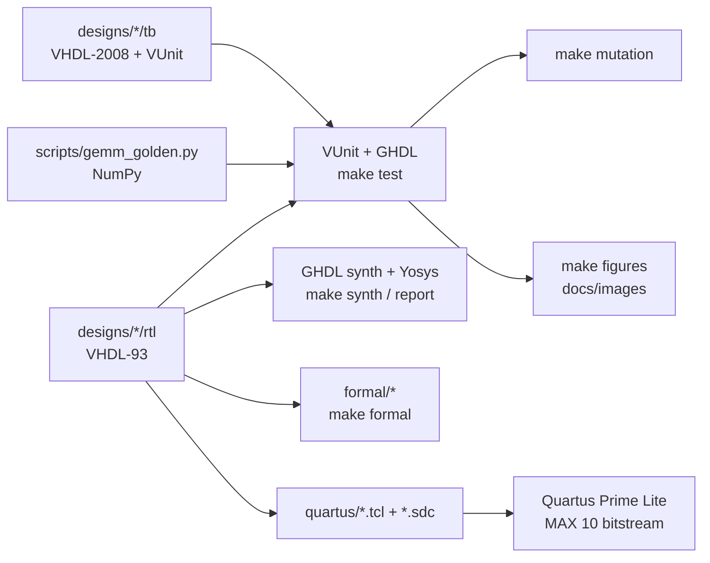

# Design flow and repository architecture

## Layout

```
designs/
  00_common/                     shared primitives (synchronizer)
  01_combinational/              adders, data routing, seven-segment display
  02_sequential/                 register, latch demo, counter
  03_systems/                    traffic light, PIC16 ALU, RAM, UART
  04_capstones/                  moving-average filter, INT8 systolic array
    <design>/
      rtl/                       synthesizable VHDL-93
      tb/                        self-checking VUnit testbenches (VHDL-2008)
      quartus/                   <project>.tcl + <project>.sdc for the MAX 10 board
      README.md                  what it does, why, how it is verified, numbers
formal/                          PSL property harnesses (proven with Yosys + Z3)
scripts/                         golden model, synthesis/formal/mutation checks,
                                 figure generator, Quartus project helper
docs/                            this documentation, figures, course slides
run.py                           the regression: every testbench, every configuration
Makefile                         one entry point for every flow
```

Everything a tool generates goes to `build/` or `vunit_out/`, which are ignored.

## Flows



| Flow | Command | Tools | Runs in CI |
|---|---|---|---|
| Simulation | `make test` | VUnit 4.7, GHDL 4.1, OSVVM, NumPy | yes |
| Synthesis gate + resources | `make synth`, `make report` | GHDL synthesis, Yosys 0.33 | yes |
| Formal proofs | `make formal` | GHDL plugin, Yosys, yosys-smtbmc, Z3 | yes |
| Mutation testing | `make mutation` | the simulation flow | yes |
| Figures | `make figures` | the simulation flow, Matplotlib | no (images are committed) |
| FPGA build | `quartus_sh -t designs/…/quartus/<project>.tcl` | Quartus Prime Lite 20.1 | no (vendor tool) |

## The FPGA build

The labs ran on an Intel **MAX 10 10M08SAE144C8G** board (Quartus Prime Lite 20.1).
The original Quartus projects were not in the repository (they were ignored by
`.gitignore`), so they are recreated by Tcl: a short spec per project
(`designs/…/quartus/<project>.tcl`: top level, sources, generics, pins) sources the
shared [`scripts/quartus/project.tcl`](../scripts/quartus/project.tcl), which builds
the project out of tree in `build/quartus/<project>/`:

```bash
quartus_sh -t designs/01_combinational/adders/quartus/ripple_carry_adder.tcl
quartus_sh --flow compile build/quartus/ripple_carry_adder/ripple_carry_adder
```

- **Board projects** (adders, demultiplexer, seven-segment, register) carry the pin
  locations recovered from the original Quartus pin reports.
- **Compile-only projects** (traffic light, ALU, RAM, UART, filter, systolic array)
  had automatic pin placement; the wide IP blocks keep their buses on-chip as
  virtual pins so that only the core is timed.
- Every project has an **SDC file**. The original compiles had none, which is
  where their critical warnings and "timing not met" results came from.

CI has no vendor tools, so it executes every project script against a
[stub of the Quartus Tcl API](../scripts/quartus/api_stub/): each script must run and
every source and constraint file it names must exist. A real Quartus compile of the
reworked designs has not been run yet. The resource numbers in the design
READMEs are labelled with their source: the 2025 lab compiles in Quartus, or a
Yosys estimate for the current RTL.
