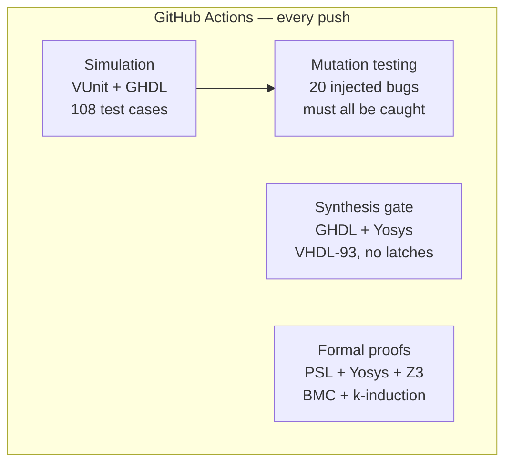

# Verification strategy

Every design is checked by machines, on every push, at several levels. No result in
this repository depends on someone looking at a waveform.



## Methods, from cheapest to strongest

| Method | Used for | Example |
|---|---|---|
| **Exhaustive** | Small input spaces: every combination is applied | Adders (131,072 vectors at 8 bit), mux/decoder, 7-segment, the PIC16 ALU (2,240,652 vectors) |
| **Reference model + random stimulus** | Sequential designs with large state spaces | Counter vs. a modulo integer, RAM vs. a shadow memory, OSVVM random data |
| **Scoreboard** | Streaming designs | Moving-average filter: the stimulus pushes expected outputs into a queue, a checker pops one per output |
| **Golden model co-verification** | Algorithms | Systolic array checked bit-exact against NumPy vectors generated before each run |
| **Bus-functional models** | Protocols | UART sender/receiver models that can be off-frequency or send broken frames |
| **Always-on monitors** | Invariants that must hold in every test | Traffic-light safety and phase-timing monitor, checked every cycle |
| **Formal proof** | Properties that must hold for *all* inputs | Traffic-light safety and response time; UART TX frame correctness |
| **Mutation testing** | The testbenches themselves | 20 realistic bugs, each must make at least one test fail |

Two design rules make the reference models trustworthy:

1. **Write the model differently from the RTL.** The ALU model decodes
   instructions by datasheet bit patterns and computes flags with integer
   comparisons; the RTL uses a `case` tree and the hardware adder trick. The
   seven-segment expectation is a list of lit segments as letters, not a copy of
   the RTL's bit table.
2. **Compare only what is architecturally visible.** The ALU check uses don't-care
   bits (`std_match`) for results that are not written and flags that are not
   updated.

## Coverage by design

| Design | Test cases | Method highlights |
|---|---:|---|
| [Adders](../designs/01_combinational/adders/) | 9 | Exhaustive at WIDTH 1, 3 and 8 |
| [Data routing](../designs/01_combinational/data_routing/) | 5 | Exhaustive; `mux(demux(d,s),s) = d`; bus contention resolves to `'X'` |
| [Seven-segment](../designs/01_combinational/seven_segment/) | 3 | Independent segment spec; ASCII rendering in the log |
| [D register](../designs/02_sequential/d_register/) | 8 | Edge polarity, async reset with the clock stopped |
| [Inferred latch](../designs/02_sequential/inferred_latch/) | 3 | Demonstrates the memory effect |
| [Up/down counter](../designs/02_sequential/up_down_counter/) | 10 | 5000 random cycles vs. model, at WIDTH 3 and 8 |
| [Traffic light](../designs/03_systems/traffic_light/) | 6 | Always-on monitor + formal proof |
| [PIC16 ALU](../designs/03_systems/pic16_alu/) | 5 | 2.24 M exhaustive vectors vs. independent model |
| [Single-port RAM](../designs/03_systems/single_port_ram/) | 6 | Shadow memory; read latency; write-first |
| [UART](../designs/03_systems/uart/) | 28 | BFMs, ±3 % baud error, framing errors, glitches, loopback; formal proof of TX |
| [Moving average](../designs/04_capstones/moving_average_filter/) | 15 | Scoreboard; impulse, step, full scale, random with gaps; N = 1, 8, 32 |
| [Systolic array](../designs/04_capstones/systolic_array/) | 10 | NumPy golden vectors, 5 array sizes, random bubbles, cycle-exact latency |

## Running it

```bash
python run.py -p 4                    # all 108 test cases (~30 s on 4 cores)
python run.py "*uart*" -v             # a subset, with full simulation output
python run.py --list                  # every test case
WAVE=build/x.vcd python run.py "lib.tb_uart_tx.fast.single_byte"   # dump a waveform
make formal  mutation  synth          # the other CI checks
```

VUnit picks GHDL by default; ModelSim/Questa (including the free Questa-Intel FPGA
Starter Edition) works too: `VUNIT_SIMULATOR=modelsim python run.py`.

## Adding a design

1. `designs/<category>/<name>/rtl/*.vhd` — VHDL-93, see [coding style](coding-style.md).
2. `designs/<category>/<name>/tb/tb_<name>.vhd` — a VUnit testbench
   (`runner_cfg` generic, `test_runner_setup` / `run("...")` /
   `test_runner_cleanup`) whose checks compare against a reference model.
3. If it has generics worth sweeping, add configurations in [`run.py`](../run.py).
4. Add the top level to `TOPS` in [`synth_check.py`](../scripts/synth_check.py)
   and at least one realistic bug to [`mutation_test.py`](../scripts/mutation_test.py).
5. `make all` must pass before pushing.
