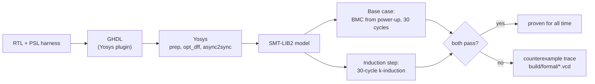

# Formal verification

Simulation checks the scenarios someone wrote down. Formal verification states the
rules as properties and lets a solver search **all** input sequences for a
violation. Each harness here wraps an unmodified RTL design and states its
requirements in PSL (the property language integrated into VHDL-2008).

| Harness | Proves |
|---|---|
| [`traffic_light/`](traffic_light/traffic_light_formal.vhd) | Lamp safety, phase order, exact phase durations, and a tight bound on how long a pedestrian waits |
| [`uart_tx/`](uart_tx/uart_tx_formal.vhd) | Every accepted byte appears on the line bit-exact, with exact bit timing; `tx_ready` is low for exactly one frame; the idle line is high |

```
make formal                                  # or: python scripts/formal_check.py
traffic_light   base case  PASS
traffic_light   induction  PASS
uart_tx         base case  PASS
uart_tx         induction  PASS
All properties proven.
```

## How the proof works



- **Base case** (bounded model check): starting from the power-up state, no input
  sequence of up to 30 cycles violates a property.
- **Induction step**: from *any* state — reachable or not — in which the
  properties held for 30 consecutive cycles, the next cycle cannot violate them.

Together they prove the properties forever. When a step fails,
`yosys-smtbmc` writes the counterexample as a VCD file into `build/formal/`; open it
in GTKWave to see exactly which input sequence breaks the property.

## Lessons from building these proofs

**The proof found a real bug.** The first traffic-light run failed in cycle 0: the
FSM's 2-bit state register has an unused fourth encoding, and without a reset the
design could power up there with no car lamp lit. The RTL now declares explicit
power-up values.

**Bounds should be tight.** The response-time property first used a guessed bound;
the proof passed with a bound one cycle shorter too, so the guess was loose.
Searching for the smallest passing bound gave the exact worst case
(`MIN_GREEN + ORANGE − 1` cycles) — one cycle less and the solver produces a
counterexample.

**Induction may start in states that cannot happen.** Twice, induction failed
because it started from an unreachable state of the *verification logic itself*: a
stale wait counter, then a reference frame with a `0` stop bit. The fix is to make
helper logic free of stale state and to state the reference model's own invariants
as assertions, which strengthens the induction hypothesis.

**A toolchain subtlety: GHDL's PSL enable flip-flops.** GHDL compiles every
`assert always` into a check guarded by a flip-flop that is initialised to `1` and
only ever holds its own value. In every reachable state it is `1`, but k-induction
may start it at `0`, which silently switches that property off in the induction
hypothesis. Proofs stay sound, but induction gets weaker. The flow runs Yosys
`opt_dff`, which folds these flip-flops into the constant they really are.

## Tools

GHDL with the Yosys plugin, Yosys (`yosys-smtbmc`) and Z3 — on Ubuntu 24.04:
`sudo apt install ghdl-mcode yosys yosys-plugin-ghdl z3`. The flow is the same as
SymbiYosys' `prove` mode, scripted directly in
[`scripts/formal_check.py`](../scripts/formal_check.py).
